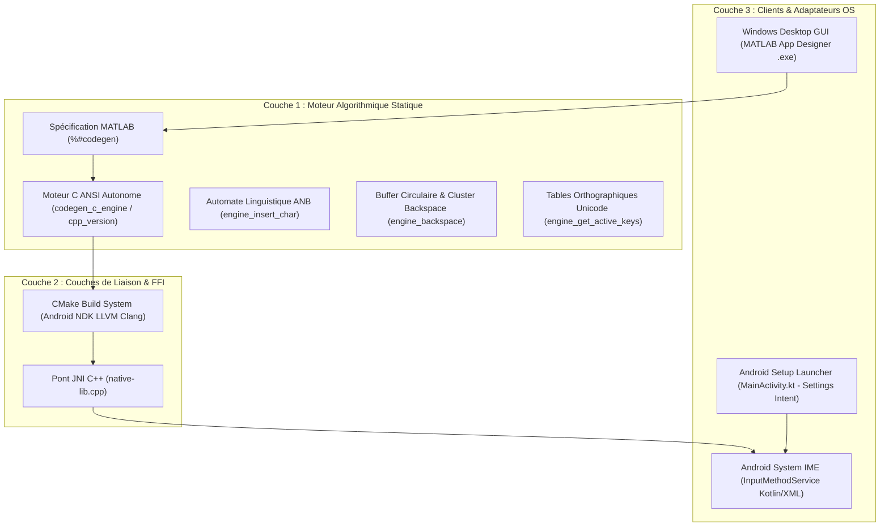
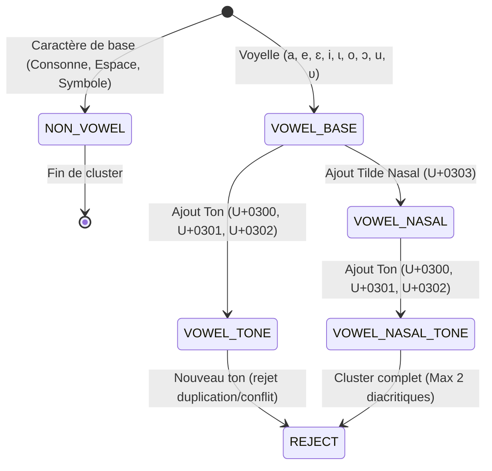
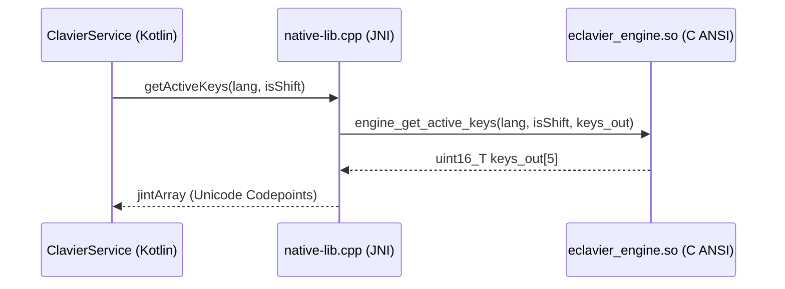

# Architecture Système & Spécifications Techniques : E_CLAVIER
**Version :** 2.0 (Dual-Target : PC Windows & Android NDK)  
**Standard Linguistique :** Alphabet National Burkinabè (ANB) & Standard Unicode (ISO/IEC 10646)  
**Institution :** École Polytechnique de Ouagadougou (EPO)

---

## 1. VISION ARCHITECTURALE : LE MODÈLE EN 3 COUCHES (3-TIER CORE)

Pour garantir à la fois l'exigence académique (validation algorithmique sous MATLAB) et le déploiement opérationnel mobile (clavier système universel Android), le projet `E_CLAVIER` est strictement partitionné en trois couches étanches :



---

## 2. COUCHE 1 : MOTEUR ALGORITHMIQUE STATIQUE (C ANSI / MATLAB CODER)

Le moteur de traitement textuel est conçu pour être 100% découplé de toute interface graphique, sans allocation dynamique (`malloc`/`free`) et déterministe.

### 2.1 Représentation de l'État (`ClavierState`)
L'état interne est matérialisé par des types discrets entiers conformes aux codepoints Unicode UTF-16 :

```c
typedef struct {
    uint16_T buffer[1024]; /* Buffer statique de codepoints Unicode */
    uint16_T text_length;  /* Nombre effectif de caractères valides */
    uint8_T  current_lang; 
    boolean_T is_shift;    
} ClavierState;
```

> [!IMPORTANT]
> **Pourquoi pas de virgule fixe ou flottante ?**  
> Les claviers traitent exclusivement des flux de symboles discrets (nombres entiers `uint16_T`, `uint8_T` et booléens `boolean_T`). Tout recours à des calculs en virgule fixe (`fixed-point`) ou flottante (`single-point`) est conceptuellement erroné, introduit du surcoût mémoire et fausse la correspondance avec la norme Unicode.

---

## 3. AUTOMATE DE VALIDATION DES DIACRITIQUES (FSM LINGUISTIQUE)

L'ANB et les règles phonologiques burkinabè imposent une hiérarchie stricte d'empilement des signes diacritiques. Un diacritique ne s'applique jamais au hasard.

### 3.1 Ordre Canonique d'Empilement
1. **Lettre de base** (Voyelle uniquement pour les tons et nasales)
2. **Nasalisation** : Tilde combinant (`U+0303`)
3. **Ton** : Bas (`U+0300`), Haut (`U+0301`), Circonflexe/Modulé (`U+0302`)



### 3.2 Règles du Moteur Linguistique
- **Rejet d'orphelin :** Tout diacritique combinant `U+0300..U+036F` arrivant sur une consonne, un chiffre, un espace ou en début de texte est strictement **rejeté**.
- **Hiérarchie Nasale -> Ton :** Le tilde nasal (`U+0303`) doit précéder l'accent de ton.
- **Suppression par Cluster de Graphèmes (Smart Backspace) :**  
  Pour éviter de laisser des accents flottants orphelins lors de la suppression, la fonction `engine_backspace` purge simultanément tous les diacritiques combinants et la voyelle de base sous-jacente.

---

## 4. COUCHE 2 : PONT JNI (JAVA NATIVE INTERFACE) & CMAKE NDK

Sur Android, le moteur C ANSI est compilé en bibliothèque partagée (`libeclavier_engine.so`) et interfacé par un wrapper JNI `native-lib.cpp` :



### Signatures des Ponts Natifs :
* `Java_com_eclavier_app_ClavierService_getActiveKeys(JNIEnv*, jobject, jint lang, jboolean shift)`
* `Java_com_eclavier_app_ClavierService_validateInsertion(JNIEnv*, jobject, jint charCode, jintArray textBuffer, jint length)`
* `Java_com_eclavier_app_ClavierService_clusterBackspace(JNIEnv*, jobject, jintArray textBuffer, jint length)`

---

## 5. COUCHE 3 : ADAPTATEURS SYSTÈME & CLIENTS

### 5.1 Cible PC Windows (MATLAB Application Compiler)
- **Interface Graphique :** Développée sous *MATLAB App Designer* (`ClavierMultilingueApp.m`).
- **Support Physique `AltGr` :** Interception native des combinaisons de touches via `WindowKeyPressFcn` et `WindowKeyReleaseFcn` pour une frappe fluide sans collision avec les touches système `F1-F12`.
- **Packaging :** Exécutable autonome compilé via `mcc` / `deploytool` avec icône personnalisée et splash screen 24bpp sans canal alpha pour prévenir les crashs Win32.

### 5.2 Cible Mobile Android v2.0 (InputMethodService & Application Compagnon)
- **Application Compagnon (`MainActivity.kt` & Material 3 Bottom Navigation) :**
  - **Menu 1 - Accueil & Bac à Sable (`HomeFragment.kt`) :** Vérification dynamique du statut du clavier (`Settings.ACTION_INPUT_METHOD_SETTINGS` et `InputMethodManager.showInputMethodPicker()`) et zone d'entraînement textuel interactive avec actions *Effacer* et *Copier*.
  - **Menu 2 - Paramètres (`SettingsFragment.kt`) :** Configuration du thème (Clair `#D1EDD3`, Sombre `#5C7057`, Automatique), retours haptiques par vibration, sons et langue par défaut.
  - **Menu 3 - À Propos (`AboutFragment.kt`) :** Valorisation académique (Initiative Étudiante EPO), liens open source GitHub / CONTRIBUTING et soutien citoyen ("Offrir un café" via Mobile Money).
- **Service Système IME (`ClavierService.kt`) :**
  - **Toolbar ANB Intégrée :** Bascule rapide de langue (Mooré, Dioula, Fulfuldé) et 4 touches directes de tons combinants (`\u0300`, `\u0301`, `\u0302`, `\u0303`).
  - **Rangée Dédiée ANB :** 5 touches de caractères spéciaux adaptées à la langue active.
  - **Pavé AZERTY Complet :** 4 rangées complètes A-Z avec majuscules Shift dynamiques, coup de glotte officiel `ʼ` (`U+02BC`), et raccourcis en appui long.
  - **Communication Inter-Applications :** Injection directe via `InputConnection` (`commitText`, `sendKeyEvent`, `deleteSurroundingText`) dans WhatsApp, Facebook, Word, SMS et navigateurs.
