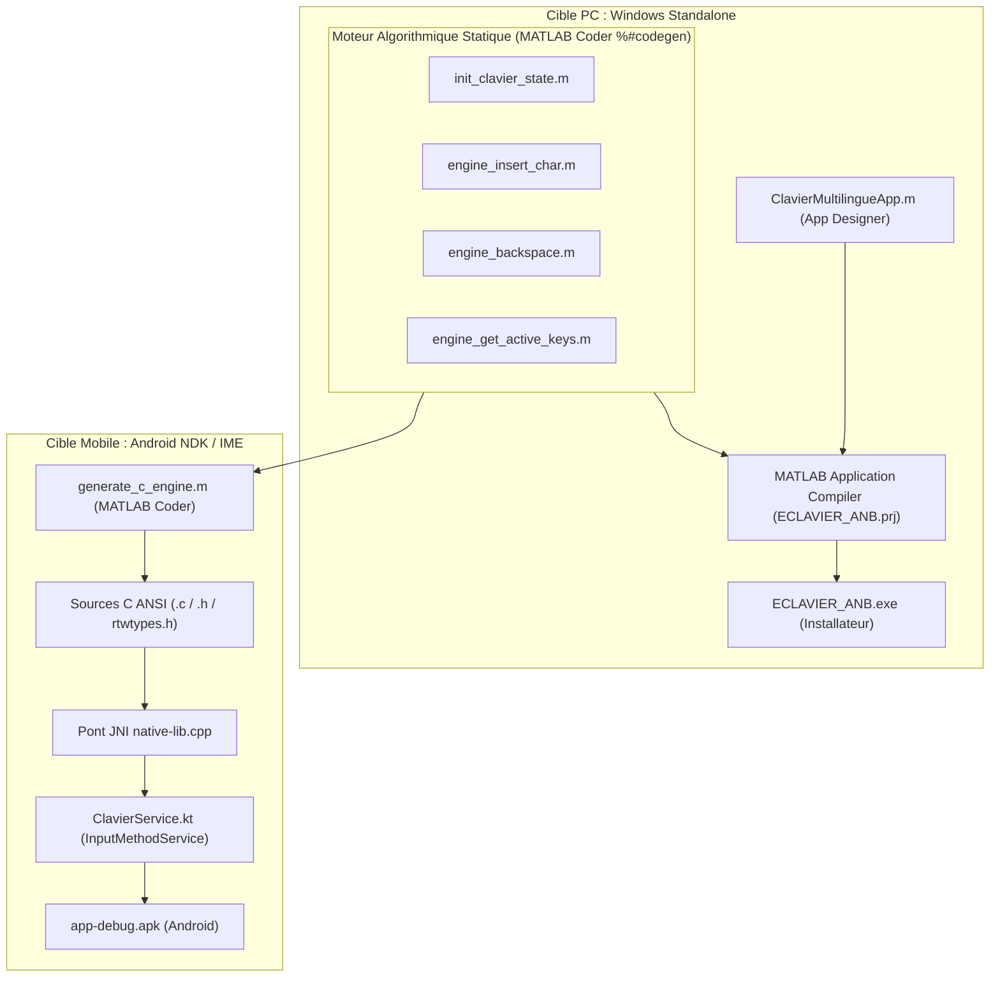

# Cahier des Charges Fonctionnel et Technique (PRD)
**Projet :** E_CLAVIER — Clavier Virtuel & Système Multilingue (Mooré, Dioula, Fulfuldé)  
**Institution :** École Polytechnique de Ouagadougou (EPO)  
**Standard Linguistique :** Alphabet National Burkinabè (ANB) & Standard Unicode (ISO/IEC 10646)  
**Version :** 2.0 (Livrables PC & Mobile)

---

## 1. Contexte & Vision du Projet

Dans le cadre de la valorisation et de la numérisation des langues nationales du Burkina Faso, **E_CLAVIER** a pour vocation de fournir une solution de saisie textuelle complète, rigoureuse et universellement accessible pour trois langues majeures :
1. **Le Mooré**
2. **Le Dioula**
3. **Le Fulfuldé**

Le projet répond à un défi double :
- **Sur le plan académique :** Valider un projet complet sous **MATLAB** en séparant rigoureusement le modèle logique (algorithmes en types statiques `%#codegen`) de la vue utilisateur (*MATLAB App Designer*), et générer un exécutable Windows autonome (`.exe`).
- **Sur le plan opérationnel & mobile :** Transpiler automatiquement le moteur logique certifié en C ANSI avec **MATLAB Coder**, puis l'intégrer via le NDK  (Native Development Kit, l’outil officiel d’Android qui permet d’écrire du code **natif en C/C++** et de l’intégrer dans une application Android , ici , il m'as servis a compiler les bibliotheques en logique C) et JNI dans un véritable service système Android (**`InputMethodService`**) pour produire un fichier installable (`.apk`) utilisable dans toutes les applications (WhatsApp, SMS, navigateur, Word).

---

## 2. Spécifications Linguistiques (Norme ANB)

### 2.1 Répertoire des Caractères Spéciaux

| Langue       | Lettres Minuscules      | Lettres Majuscules      | Points de Code Unicode                                                                              |
| :----------- | :---------------------- | :---------------------- | :-------------------------------------------------------------------------------------------------- |
| **Mooré**    | `ɛ`, `ɩ`, `ʋ`, `ʼ`      | `Ɛ`, `Ɩ`, `Ʋ`, `ʼ`      | `U+025B`, `U+0269`, `U+028B`, `U+02BC` / `U+0190`, `U+0196`, `U+01B2`                               |
| **Dioula**   | `ɛ`, `ɔ`, `ɲ`, `ŋ`      | `Ɛ`, `Ɔ`, `Ɲ`, `Ŋ`      | `U+025B`, `U+0254`, `U+0272`, `U+014B` / `U+0190`, `U+0186`, `U+019D`, `U+014A`                     |
| **Fulfuldé** | `ɓ`, `ɗ`, `ƴ`, `ɲ`, `ŋ` | `Ɓ`, `Ɗ`, `Ƴ`, `Ɲ`, `Ŋ` | `U+0253`, `U+0257`, `U+01B4`, `U+0272`, `U+014B` / `U+0181`, `U+018A`, `U+01B3`, `U+019D`, `U+014A` |

> [!NOTE]
> Le coup de glotte / saltillo en Mooré est encodé par la consonne officielle **`U+02BC`** (*Modifier Letter Apostrophe* `ʼ`) et non par le guillemet informatique ASCII `39` (`'`).
> Source:https://mail.academiedepolice.bf/index.php/telechargement/category/59-enseignement?download=183%3Aloi-portant-loi-d-orientation-sur-les-modalites-de-promotion-et-d-officialisation-des-langues-nationales-du-burkina-faso

### 2.2 Diacritiques Combinants (Tons et Nasalisation)
Les signes diacritiques s'appliquent en post-position sur les voyelles (`a, e, i, o, u, ɛ, ɩ, ʋ, ɔ`) :
1. **Ton Bas :** Accent grave combinant `U+0300` (`◌̀`)
2. **Ton Haut :** Accent aigu combinant `U+0301` (`◌́`)
3. **Ton Circonflexe / Modulé :** Circonflexe combinant `U+0302` (`◌̂`)
4. **Nasalisation :** Tilde combinant `U+0303` (`◌̃`)
>[!NOTE]
>Source: https://fasocheck.org/fact-checking/burkina-le-moore-nest-pas-devenu-la-seule-langue-officielle-et-denseignement

### 2.3 Garde-fous Linguistiques (Automate d'Insertion)
- **Rejet d'orphelins :** Interdiction stricte d'insérer un diacritique en début de texte, après un espace, ou sur une consonne.
- **Empilement maximal :** Maximum 2 diacritiques combinés par voyelle (ex : voyelle nasalisée avec ton `ɛ̃́`).
- **Suppression par Cluster (Smart Backspace) :** Un appui sur Retour efface la voyelle et l'ensemble de ses diacritiques rattachés pour éviter de laisser des accents flottants orphelins.

---

## 3. Spécifications Ergonomiques & Raccourcis PC (`AltGr`)

Pour éliminer les conflits avec les touches système `F1–F12`, la saisie physique sur PC s'appuie sur le standard industriel **`AltGr`** :

* **Lettres ANB :** `AltGr + Touche Latine` (ex : `AltGr + E` -> `ɛ`, `AltGr + I` -> `ɩ`, `AltGr + U` -> `ʋ`, `AltGr + '` -> `ʼ`).
* **Tons & Nasalisation :** `AltGr + Chiffres` (`AltGr + 1` = Ton bas, `AltGr + 2` = Ton haut, `AltGr + 3` = Circonflexe, `AltGr + 4` = Nasal).
* **Synchronisation Shift :** Maintien de la touche `Shift` ou verrouillage `CapsLock` physique basculant instantanément l'interface graphique en mode Majuscules.

---

## 4. Architecture Technique & Déploiement Multi-Cibles

---

## 5. Livrables Validés du Projet

| Livrable | Cible | Format | Statut |
| :--- | :--- | :--- | :--- |
| **Moteur Logique ANB** | Multiplateforme | Scripts MATLAB `%#codegen` (`engine_*.m`) | **Validé & Certifié** |
| **Application PC Autonome** | Windows 10 / 11 | `releases/ECLAVIER_ANB.exe` (via App Compiler) | **Compilé & Testé** |
| **Moteur C Transpilé** | Systèmes C/C++ | Sources C ANSI dans `cpp_version/` | **Généré & Autonome** |
| **Application & Clavier Mobile v2.0** | Android 7.0+ (API 24 à 36) | `releases/app-debug.apk` (IME complet + 3 Menus) | **Compilé & Fonctionnel** |
| **Documentation & Spécifications** | Open Source | Dossier `docs/`, `README.md`, `DEVELOPER_GUIDE.md` | **Complet & À Jour** |
